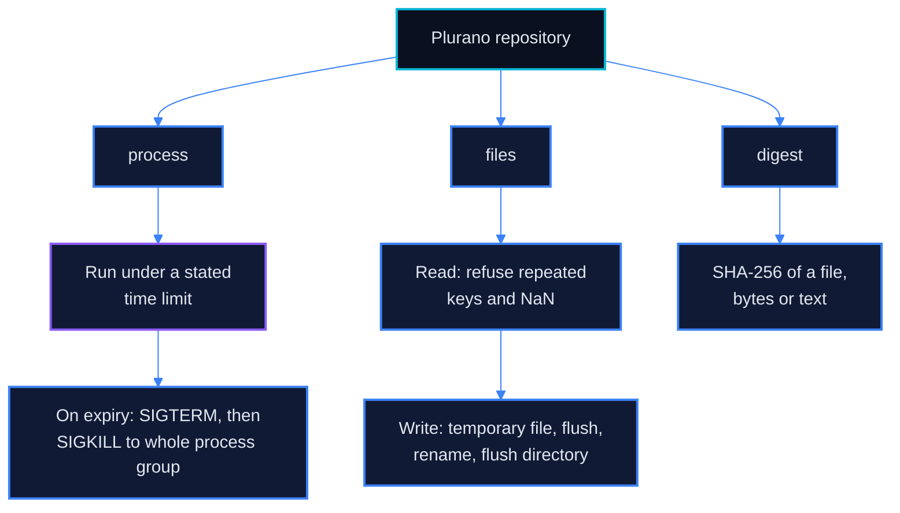

<!-- markdownlint-disable MD013 MD023 MD033 MD036 MD041 -->
<!-- A centred header needs inline HTML, a banner image, indented headings and
     badge lines past 80 columns, so those five rules are off for this file.
     The prose below still wraps at 80. -->
<div align="center">

  

  <!-- badge block: one group, fixed order -->
  <!-- 1 release/version -->
  [](https://github.com/plurano/cistula/releases)
  [](https://pypi.org/project/cistula/)
  [](https://pypi.org/project/cistula/)
  <!-- 2 CI/build -->
  [](https://github.com/plurano/cistula/actions/workflows/ci.yml)
  [](https://github.com/plurano/cistula/actions/workflows/reuse.yml)
  [](https://github.com/plurano/cistula/actions/workflows/pages.yml)
  <!-- 3 security/scorecard -->
  [](https://github.com/plurano/cistula/actions/workflows/codeql.yml)
  [](https://app.codacy.com/gh/plurano/cistula/dashboard)
  [](https://coderabbit.ai)
  <!-- 4 standards -->
  [](https://github.com/plurano/cistula/blob/main/AGENTS.md)
  [](https://github.com/plurano/cistula/blob/main/CONTRIBUTING.md#modernized-nasa-jpl-power-of-10-rules)
  [](https://github.com/plurano/cistula/blob/main/CONTRIBUTING.md#commit-messages)
  <!-- 5 licence -->
  [](https://github.com/plurano/cistula/blob/main/LICENSE)
  <!-- 6 support -->
  [](https://github.com/sponsors/lusoris)
  [](https://ko-fi.com/lusoris)

  **One tested copy of the helpers every Plurano repository repeated**

  *Commands under a time limit, strict JSON, files replaced in one step, SHA-256 digests*

</div>

Shared Python helpers of the Plurano framework family: one tested
implementation of the helpers that every repository used to repeat.

**[Documentation](https://plurano.github.io/cistula/)** · [Documentation source](https://github.com/plurano/cistula/tree/main/docs)

## Name

Cistula (pronounced KIS-tu-la) is Latin for a small chest: the case that held
a craftsman's or a scribe's small tools. The word is the diminutive of *cista*,
from Greek *kiste*. The repository, the distribution and the import package
all carry the name `cistula`.

## Why Cistula

- Uses the standard library only, and no function contacts a network.
- `run` has no default time limit and kills the whole process group when it
  expires.
- `read_json` refuses repeated keys and `NaN` / `Infinity`.
- The writers replace a file in one step and are durable by default.
- The same commit builds the same package bytes on every host and every
  supported interpreter.
- Every public function has positive, negative and boundary tests, with 100 %
  branch coverage required.

## Get started

### Install

```sh
pip install cistula
```

The package is on [PyPI](https://pypi.org/project/cistula/).

A consumer can also install a wheel built from a commit and pin its hash:

```sh
make package          # prints the SHA-256 of dist/*.whl
pip install --require-hashes -r requirements.txt
```

with this line in the consumer's `requirements.txt`:

```text
cistula @ file:///path/to/dist/cistula-0.1.0-py3-none-any.whl --hash=sha256:<hash printed by make package>
```

The bytes of the wheel and of the source distribution depend on the commit
only: every host and every supported interpreter builds the same two files
from the same commit. The hash to pin is the one `make package` prints for
that commit, and a second build of it must print the same
(see [Reproducible package](https://plurano.github.io/cistula/development/#reproducible-package)).

### First use

```python
from cistula import read_json, run, sha256_file, write_json

result = run(["git", "rev-parse", "HEAD"], timeout=30, check=True)
record = read_json("record.json")
record["commit"] = result.stdout.strip()
record["digest"] = sha256_file("artifact.bin")
write_json("record.json", record)
```

## At a glance



Three modules. They use the standard library only, and no function contacts a
network.

| Module | What it does |
| --- | --- |
| `process` | `run` starts a command under a time limit the caller must state. `child_env` builds the environment for such a child. |
| `files` | `read_json` and `loads_json` refuse a repeated key and a number JSON does not have. `read_json_lines` and `loads_json_lines` read JSON Lines with the same checks and name the line of a bad row. `write_json_lines` replaces a JSON Lines file in one step. `write_bytes_atomic`, `write_text_atomic` and `write_json` replace a file in one step. `open_bytes_atomic`, `open_text_atomic` and `staged_path` do that for content written in a `with` block. Files that can be made again (caches, per-item results) take `durable=False`; everything else keeps the default, which costs milliseconds per file (see [Guarantees](https://plurano.github.io/cistula/guarantees/)). |
| `digest` | `sha256_file`, `sha256_bytes` and `sha256_text`. |

## Guides and reference

### On the documentation site

- [Guarantees](https://plurano.github.io/cistula/guarantees/) — required time
  limits, process-group kill, atomic and durable writes, and strict JSON.
- [Limits](https://plurano.github.io/cistula/limits/) — Linux-only test
  coverage, session-escaping descendants, leftover temporary files on kill, and
  Python 3.11 floor.
- [Compared with other libraries](https://plurano.github.io/cistula/comparison/)
  — comparison against PyPI releases and their source for atomic writes,
  subprocesses, JSON reading and digests.
- [Development](https://plurano.github.io/cistula/development/) — the
  `make verify-all` verification gate, reproducible packages, supported Python
  versions and exceptions.
- [Decision records](https://github.com/plurano/cistula/tree/main/docs/adr) —
  architectural decision records.
- [CHANGELOG](https://github.com/plurano/cistula/blob/main/CHANGELOG.md) —
  release history.

## Contribute

```sh
make verify-all
```

This is the whole gate, and CI runs the same target. What it needs and runs is
on the [Development](https://plurano.github.io/cistula/development/) page.

See
[CONTRIBUTING.md](https://github.com/plurano/cistula/blob/main/CONTRIBUTING.md)
and [SECURITY.md](https://github.com/plurano/cistula/blob/main/SECURITY.md).

## Support

Questions, ideas and defects go to
[issues](https://github.com/plurano/cistula/issues), and security reports to a
[private advisory](https://github.com/plurano/cistula/security/advisories/new),
as [SECURITY.md](https://github.com/plurano/cistula/blob/main/SECURITY.md) asks.

The maintainer's work on the Plurano libraries can be sponsored on
[GitHub Sponsors](https://github.com/sponsors/lusoris),
[Ko-fi](https://ko-fi.com/lusoris) or
[Patreon](https://www.patreon.com/Lusoris), any amount; sponsors are thanked,
and no support or priority is sold.

## Roadmap and releases

The repository is public. The version is `0.1.0`, the first release
([CHANGELOG](https://github.com/plurano/cistula/blob/main/CHANGELOG.md)). A
version tag builds, signs and attests the release files and uploads the
packages to [PyPI](https://pypi.org/project/cistula/). Planned work is tracked
in [milestones](https://github.com/plurano/cistula/milestones).

## Licence

EUPL-1.2, see [LICENSE](https://github.com/plurano/cistula/blob/main/LICENSE).

## Standards and governance

This repository follows the High-Integrity Systems Standards (HISS-21) and the
NASA/JPL Power of 10 rules; see
[AGENTS.md](https://github.com/plurano/cistula/blob/main/AGENTS.md) and
[CONTRIBUTING.md](https://github.com/plurano/cistula/blob/main/CONTRIBUTING.md).

<!-- praetor:readme-governance:start -->
Praetor manages this repository's declared governance policy. This managed
block records adoption state; it is not a verification certificate.

**Verification**: `make verify-all` runs the repository's configured
verification cascade.

**HISS Audit**: `praetorctl audit` enforces policy, generated-surface
integrity, and the debt ratchet.

**Context Sync**: `praetorctl compile-context --verify` verifies every
generated agent context against `AGENTS.md`.

**Debt Baseline**: `.standards-baseline.json` anchors the debt ratchet at
0 recorded infractions; audit forbids growth.
<!-- praetor:readme-governance:end -->
