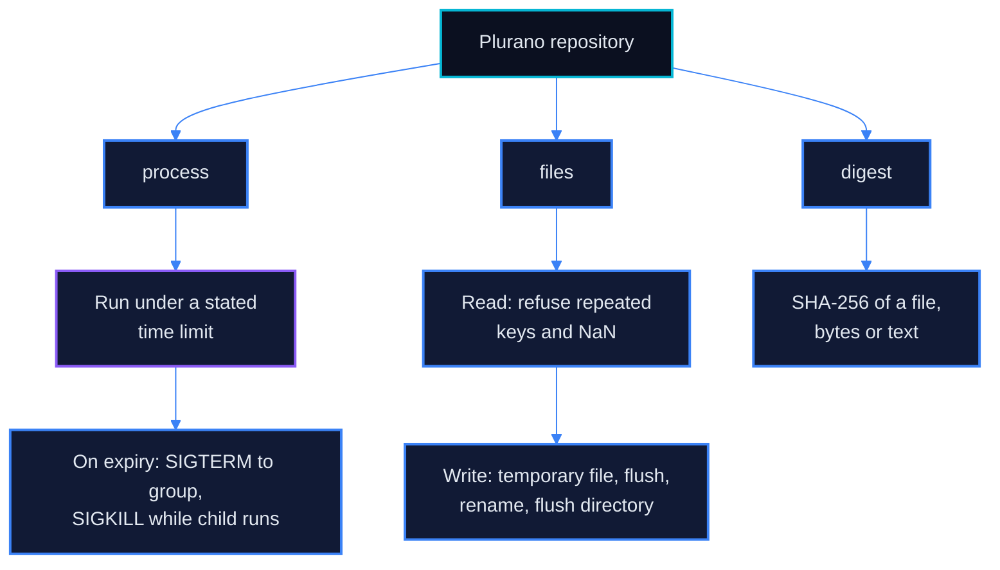

<!--
SPDX-FileCopyrightText: 2026 Lusoris <lusoris@proton.me>
SPDX-License-Identifier: EUPL-1.2
-->

# Cistula

Shared Python helpers of the Plurano framework family: one tested
implementation of the helpers that every repository used to repeat.

Cistula (pronounced KIS-tu-la) is Latin for a small chest: the case that held
a craftsman's or a scribe's small tools. The word is the diminutive of *cista*,
from Greek *kiste*. The repository, the distribution and the import package
all carry the name `cistula`.

- Uses the standard library only, and no function contacts a network.
- `run` has no default time limit and sends the whole process group `SIGTERM`
  when it expires, then `SIGKILL` while the child runs or its output pipes stay
  open.
- `read_json` refuses repeated keys and `NaN` / `Infinity`.
- The writers replace a file in one step and are durable by default.
- The same commit builds the same package bytes on every host and every
  supported interpreter.
- Every public function has positive, negative and boundary tests, with 100 %
  branch coverage required.

| Module | What it does |
| --- | --- |
| `process` | `run` starts a command under a time limit the caller must state. `child_env` builds the environment for such a child. |
| `files` | `read_json` and `loads_json` refuse a repeated key and a number JSON does not have. `read_json_lines` and `loads_json_lines` read JSON Lines with the same checks and name the line of a bad row. `write_json_lines` replaces a JSON Lines file in one step. `write_bytes_atomic`, `write_text_atomic` and `write_json` replace a file in one step. `open_bytes_atomic`, `open_text_atomic` and `staged_path` do that for content written in a `with` block. Files that can be made again (caches, per-item results) take `durable=False`; everything else keeps the default, which costs milliseconds per file (see [Guarantees](guarantees.md)). |
| `digest` | `sha256_file`, `sha256_bytes` and `sha256_text`. |

## Pages

- [Guarantees](guarantees.md)
- [Limits](limits.md)
- [Compared with other libraries](comparison.md)
- [Development](development.md)
- [Architectural Decision Records](adr/README.md)

Install steps are in the
[repository README](https://github.com/plurano/cistula#get-started).
